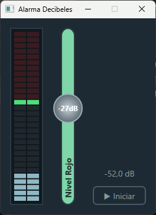
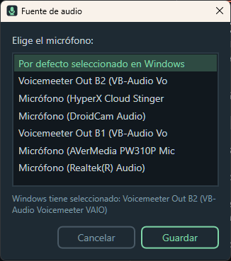

# 🔊 AlarmaDecibeles

**Una alarma que te avisa cuando estás hablando muy fuerte.**

¿Reuniones en las que terminas gritando sin darte cuenta? ¿Llamadas nocturnas con gente durmiendo al lado? AlarmaDecibeles escucha tu micrófono y suena apenas pasas el volumen que tú elijas.

<p align="center">
  
  &nbsp;&nbsp;
  
</p>
<p align="center"><sub>La ventana principal escuchando el micrófono · El selector de fuente de audio</sub></p>

## ✨ Cómo funciona

| | |
|---|---|
| 🎚️ **Fader "Nivel Rojo"** | Arrastra la perilla para elegir el máximo de decibeles permitido. Todo lo que quede sobre ese nivel es la zona roja. |
| 📊 **Medidor LED** | Muestra en vivo el volumen del micrófono. La línea verde marca tu límite y los segmentos rojos se encienden cuando te pasas. |
| 🔔 **Alarma** | Suena un beep apenas pasas el límite. Si sigues en rojo, vuelve a sonar cada 5 segundos. |
| 🎤 **Micrófono** | Elige qué entrada de audio escuchar, o deja **"Por defecto seleccionado en Windows"** para usar la que tengas configurada en Windows. Pasa el mouse sobre el botón para ver cuál está activa. |
| ▶️ **Iniciar / Detener** | La app solo escucha cuando tú se lo pides. Si el micrófono se desconecta mientras escucha, te avisa en vez de quedarse callada. |
| 💾 **Recuerda tu configuración** | El micrófono y el nivel rojo quedan guardados para la próxima vez. |

## 📥 Descarga

<p align="center">
  <a href="https://github.com/juanes1eban/AlarmaDecibeles/releases/latest/download/AlarmaDecibeles-Setup.exe"><b>⬇️ Descargar AlarmaDecibeles-Setup.exe</b></a>
  <br>
  <sub>Windows 10/11 de 64 bits · No necesitas instalar nada más · <a href="https://github.com/juanes1eban/AlarmaDecibeles/releases">Todas las versiones</a></sub>
</p>

El instalador no pide permisos de administrador. Crea un acceso directo en el menú Inicio y se desinstala desde **Configuración → Aplicaciones**.

> [!WARNING]
> **Windows puede mostrar "Windows protegió tu PC".**
> El instalador no tiene firma digital (el certificado es pagado), así que SmartScreen no lo reconoce. Para instalarlo igual:
>
> 1. Haz clic en **Más información**.
> 2. Haz clic en **Ejecutar de todas formas**.
>
> Si prefieres no confiar en el `.exe`, puedes [compilarlo tú mismo desde el código](#compilar).

## 🚀 Cómo usarla

1. Abre **Alarma Decibeles** desde el menú Inicio.
2. Aprieta **▶ Iniciar** y habla normal para ver dónde queda tu nivel.
3. Sube o baja el fader hasta dejar el límite un poco por encima de tu voz normal. Listo.

> 💡 **Tip:** parte con el límite alrededor de **−20 dB** y ajusta desde ahí. Cada micrófono capta distinto.

### ⚙️ Configuración

Tus preferencias se guardan en `%APPDATA%\AlarmaDecibeles\settings.json`:

```json
{
  "MicName": "Micrófono (Realtek(R) Audio)",
  "ThresholdDb": -20
}
```

El micrófono se guarda cuando aprietas **Guardar** en el selector, y el nivel rojo al cerrar la app. `"MicName": null` significa "por defecto de Windows", que también es lo que se usa si el micrófono guardado ya no está conectado. Para volver a los valores de fábrica, borra el archivo.

## 📏 Sobre los decibeles

Los valores que ves son **dBFS**: decibeles relativos al máximo que puede captar tu micrófono. Van de **−60 dB** (silencio) a **0 dB** (el tope). No equivalen a los dB de un sonómetro, así que el mismo número puede sonar distinto en otro micrófono o con otra ganancia. Lo que importa es calibrar el fader con tu propio equipo.

## 🏷️ Versiones

La versión actual aparece bajo el botón **Micrófono**, con el formato `v1.00.001`, `v1.00.002`, etc. Los cambios de cada versión están en [Releases](https://github.com/juanes1eban/AlarmaDecibeles/releases).

<a id="compilar"></a>

## 🛠️ Compilar desde el código

1. Instala el [SDK de .NET 10](https://aka.ms/dotnet/download).
2. Clona el repo y córrelo:

   ```powershell
   git clone https://github.com/juanes1eban/AlarmaDecibeles.git
   cd AlarmaDecibeles
   dotnet run
   ```

## 🧰 Hecho con

- [WPF](https://learn.microsoft.com/dotnet/desktop/wpf/) sobre .NET 10
- [NAudio](https://github.com/naudio/NAudio) para capturar el micrófono

## 📄 Licencia

[GPL-3.0](LICENSE)
